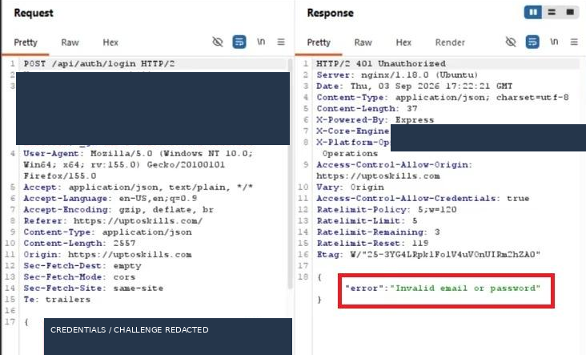
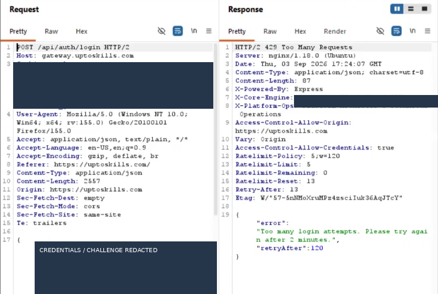
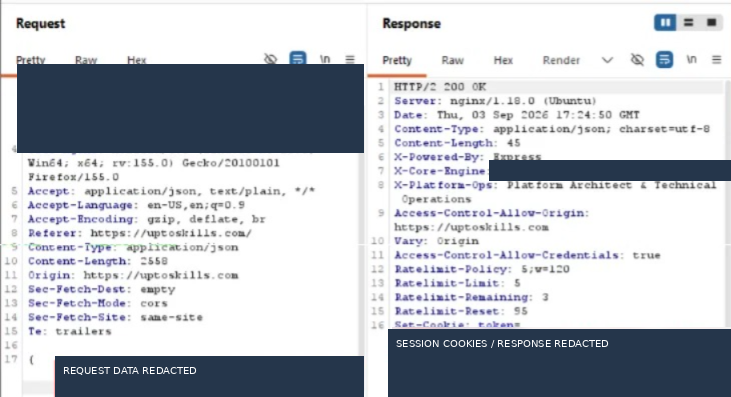

# Email Case Variation and Login Rate Limiting

> **Question:** Can different capitalization of the same email address evade the login endpoint's failed-attempt counter?
>
> **Result:** During manual security testing of the login endpoint, an inconsistent rate-limiting behavior was observed when changing the capitalization of an email address. The endpoint initially enforced login throttling with HTTP 429 Too Many Requests. Its captured responses show an initial `401`, a rate-limited `429`, a subsequent `401` for a case-variant email, and then a `200` with authentication cookies. 
> 
> **Scope:** Authorized testing conducted on **3 September 2026**. The vulnerability was subsequently remediated by the organization following this disclosure.

## 1. At a glance

| Field | Finding |
| --- | --- |
| Research topic | Case-sensitive email identifiers and login rate-limit counters |
| Application | UpToSkills |
| Observed endpoint | `POST https://gateway.uptoskills.com/api/auth/login` |
| Base URL in written report | `https://gateway.uptoskills.in` |
| Class | Rate-limit logic / identifier canonicalization |
| Severity | **Medium** |
| Observed server policy header | `RateLimit-Policy: 5;w=120` |
| Evidence status | Rate limiting confirmed, capitalization-based bypass **inconclusive** |

## 2. Background: why email canonicalization matters

A login rate limiter should protect the *account*, not merely a particular spelling of its identifier. If the login system recognizes `researcher@example.invalid` and `Researcher@example.invalid` as the same account, then per-account failed-login counters generally need to treat those inputs as the same identity as well.

A possible implementation mistake is to derive the counter key directly from the raw, unnormalized email string:

```text
Hypothetical weak design                 Intended account-level behavior

"researcher@example.invalid" ──► key A   "researcher@example.invalid" ─┐
"Researcher@example.invalid" ──► key B   "Researcher@example.invalid" ─┴─► one account counter
```

## 3. Test setup and evidence handling

The assessment was performed through the login endpoint with Burp Suite Repeater. The test account's email capitalization was changed between requests. The screenshots show the same API path, rate-limit headers, and HTTP outcomes.

## 4. Reproduction sequence and recorded results

### Step 1 - Capture an invalid login attempt

A login request was captured for an test account. The server denied the attempt with a generic authentication failure.

**Recorded response excerpt:**

```http
HTTP/2 401 Unauthorized
Date: Thu, 03 Sep 2026 17:22:21 GMT
RateLimit-Policy: 5;w=120
RateLimit-Limit: 5
RateLimit-Remaining: 3
RateLimit-Reset: 119
Content-Type: application/json; charset=utf-8

{"error":"Invalid email or password"}
```



*Figure 1 - Initial `401 Unauthorized`. The server reports an attempt budget and a 120-second window.*

### Step 2 - Observe the rate limiter activate

After additional failed attempts, the same endpoint returned `429 Too Many Requests`. The evidence confirms that **a rate limiter exists**.

**Recorded response excerpt:**

```http
HTTP/2 429 Too Many Requests
Date: Thu, 03 Sep 2026 17:24:07 GMT
RateLimit-Policy: 5;w=120
RateLimit-Remaining: 0
RateLimit-Reset: 13
Retry-After: 13
Content-Type: application/json; charset=utf-8

{
  "error": "Too many login attempts. Please try again after 2 minutes.",
  "retryAfter": 120
}
```



*Figure 2 - Protection activated. Crucially, `Retry-After` **120 seconds***

**Observation:** The JSON `retryAfter` mentions 120 seconds in response.

### Step 3 - Change the email's letter case and retry

Change the capitalization of alphabetic characters in the email address, without treating it as a different logical account. The next captured request returned `401 Unauthorized` instead of the previous `429`.

**Recorded response excerpt:**

```http
HTTP/2 401 Unauthorized
Date: Thu, 03 Sep 2026 17:24:25 GMT
RateLimit-Policy: 5;w=120
RateLimit-Remaining: 4
RateLimit-Reset: 120

{"error":"Invalid email or password"}
```


*Figure 3 - Case-variant request returned `401`, with `RateLimit-Remaining: 4` and `RateLimit-Reset: 120`.*

### Step 4 - Review the later successful login response

A further request returned `HTTP 200 OK`, with `Set-Cookie` headers for authentication tokens.
**Recorded response excerpt:**

```http
HTTP/2 200 OK
Date: Thu, 03 Sep 2026 17:24:50 GMT
RateLimit-Policy: 5;w=120
RateLimit-Remaining: 3
RateLimit-Reset: 95
Set-Cookie: token=<REDACTED>
Set-Cookie: refreshToken=<REDACTED>
```



*Figure 4 - Later `200 OK`*

A `200 OK` accompanied by authentication cookies indicates a successful authentication response. 

## 5. Evidence timeline

| Response | Timestamp (UTC) | Time since `429` | Remaining/reset reported | Interpretation |
| --- | --- | --- | --- | --- |
| Initial `401` | 17:22:21 | - | 3 remaining; 119 s reset | Authentication failure with rate tracking |
| `429` | 17:24:07 | 0 s | 0 remaining; **13 s reset** | Rate limiting confirmed |
| Case-variant `401` | 17:24:25 | **+18 s** | 4 remaining; 120 s reset | Consistent with a new window **or** an identifier-based reset |
| Later `200` | 17:24:50 | **+43 s** | 3 remaining; 95 s reset | Successful logged in |

## 6. Expected behavior vs. what the test establishes

| Question | Expected behavior | What the evidence establishes |
| --- | --- | --- |
| Are repeated login attempts limited? | Eventually reject excessive failures | **Yes** - the endpoint returned `429` |
| Do case variants share one account-level limiter? | Yes, if they refer to the same account | **Not conclusively tested within a still-active cooldown** |
| Did the case variant obtain additional attempts before reset? | Should not, if account-wide throttling is active | **Unresolved** - captured attempt followed the reported reset time |
| Did any test bypass password authentication? | No | **No authentication bypass** |
| Is the limiter keyed by raw email strings? | Ideally use a stable account identifier | **Hypothesis, backend implementation not inspected** |

## 7. Security impact and limits

**Confirmed:** A login rate limiter was present, visibly blocked attempts with HTTP 429, and later accepted new requests before the reset timeline.

**Potential impact:** A limiter keyed to raw email input could grant additional password-guessing attempts through case variations for the same underlying account, reducing the effectiveness of per-account throttling and credential-stuffing defenses.

## 8. Recommended hardening

- **Key throttling to a stable account identity:** For known accounts, derive the failed-login counter from an internal account ID rather than the raw request email.
- **Normalize consistently:** Apply the application's documented email-identity rules before account lookup and rate-limit evaluation. Handle provider-specific email semantics deliberately; do not assume every provider treats all local-part variations identically.
- **Combine signals:** Maintain suitable per-account and per-source protections to deter distributed guessing and identifier variation.
- **Make cooldown information consistent:** Align `Retry-After`, body `retryAfter`, and UI messaging so analysts and users see one coherent duration.
- **Add regression tests:** Verify different capitalization, whitespace handling, and permitted equivalent identifiers share the intended counters and cannot silently reset protection.
- **Instrument safely:** Log rate-limit decisions and canonical account identifiers without exposing passwords, CAPTCHA tokens, or authentication cookies.

## 9. Conclusion

This assessment highlights a subtle authentication-security question: **whether failed-login protection follows a normalized account identity or a raw input string**. The test positively establishes that throttling exists. The attributes later accepted requests to changing the email's case.

---
