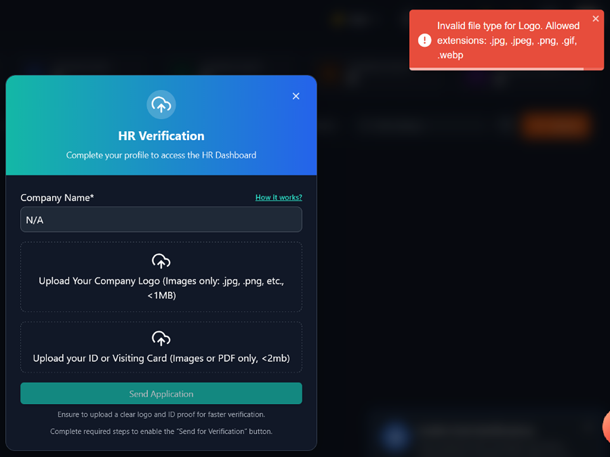
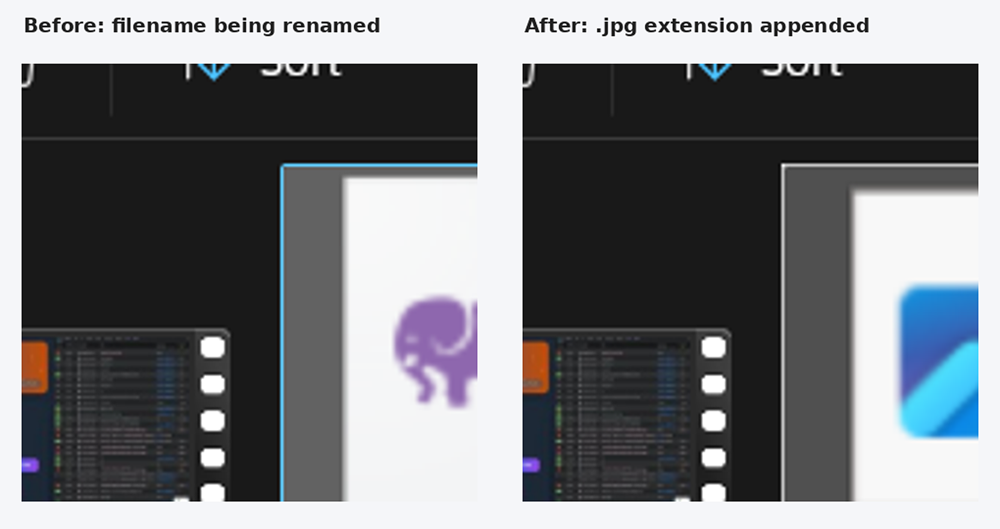
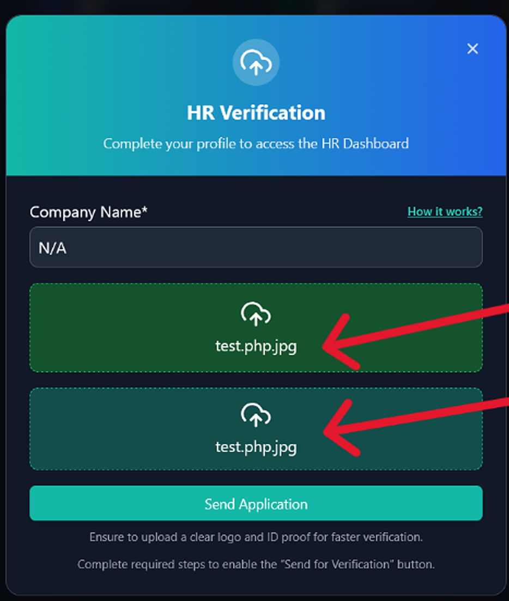
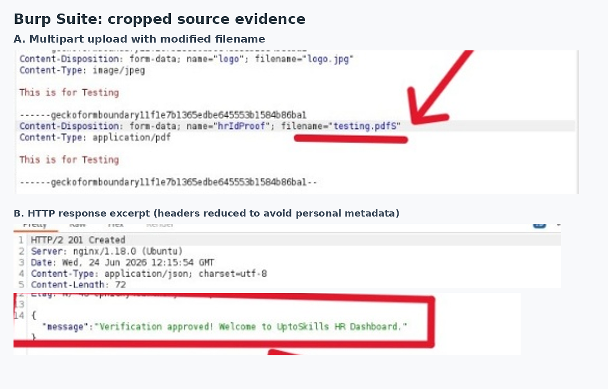
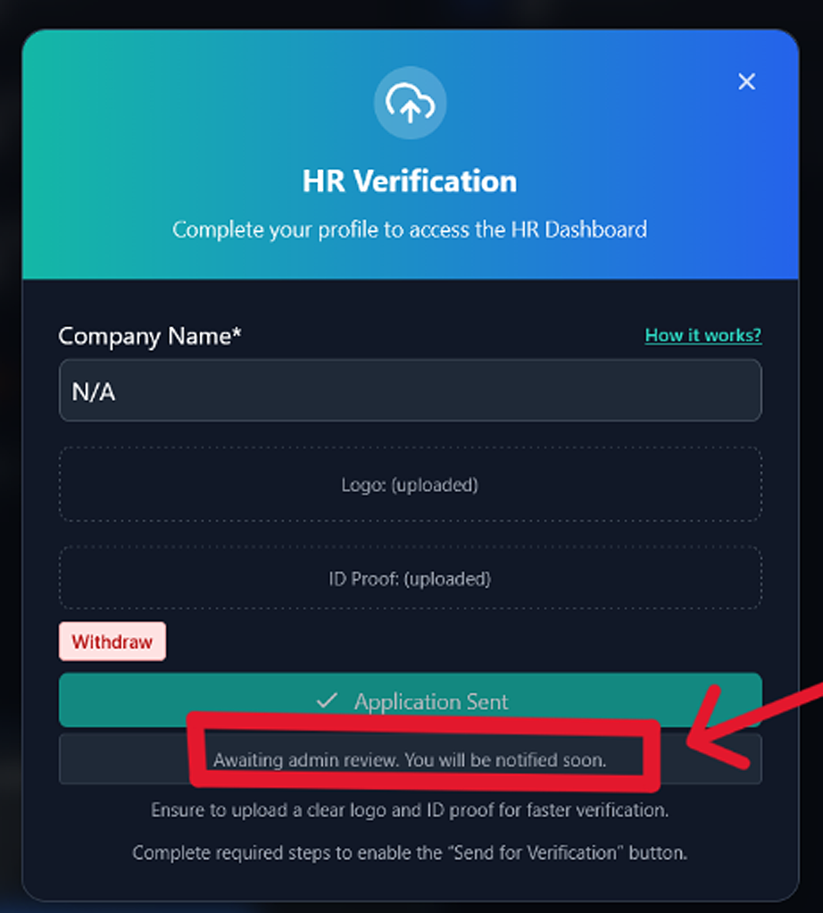

# File Upload Validation Bypass via Filename Manipulation

**Web application security · multipart/form-data · upload validation · Burp Suite**

> **Key finding:** In a historical HR-verification assessment, an unsupported `.php` filename was rejected by the browser interface, while adding `.jpg` made the same filename selectable. More importantly, a modified multipart upload using `filename="testing.pdfS"` received **HTTP 201 Created** and an application success message. These observations support inconsistent file-validation controls, but they do **not** demonstrate execution of uploaded PHP code or access to stored files.
>
> **Assessment date:** 25 June 2026. This write-up is based on the supplied report and its screenshots; it is **not** a claim about the application's current state.

## 1. Vulnerability overview

| Field | Details |
| --- | --- |
| Original report | *File Upload Validation Bypass Across Multiple Upload Functionalities* |
| Platform | UpToSkills |
| Primary flow | HR verification, including company-logo and HR ID-proof uploads |
| Category | Improper file type and content validation |
| Testing method | Manual authorized security testing |
| Tools listed in source | Browser Developer Tools and Burp Suite Professional (one screenshot shows Burp Suite Community Edition) |
| Test date | **25 June 2026** |
| Direct screenshot evidence | HR verification upload interface and `company-verification` multipart request/response |

### Affected endpoints identified by the source

The source report names the following three API paths:

| API path | Reported function | Evidence strength in this document |
| --- | --- | --- |
| `https://gateway.uptoskills.com/api/company-profile/company-verification` | HR ID proof / company verification | **Directly illustrated** by the Burp request and response screenshot |
| `https://gateway.uptoskills.com/api/company-profile` | Company logo / profile | **Reported** as similarly affected; no separate complete request/response pair shown in this document |
| `https://gateway.uptoskills.com/api/hr/save-profile` | HR profile | **Reported** as similarly affected; no separate complete request/response pair shown in this document |

The report also references a video demonstrating all three flows. That video was **not reviewed for this public Markdown reconstruction**, so the endpoint-specific conclusions above rely on the supplied document images.

## 2. Technical background: the upload trust boundary

A file-input component can restrict the filenames shown to a user or reject unexpected extensions. This improves usability, but it is not a security boundary: the client controls the filename, declared MIME type, and uploaded bytes in an HTTP multipart request.

A robust upload handler decides what is permitted **on the server**, checking the type and format appropriate to each upload field before accepting or storing the content. A filename ending in `.jpg` is not proof that the content is an image, and a multipart `Content-Type: application/pdf` label is not proof that the bytes form a valid PDF.

For this case, the distinction matters because the evidence describes two different checks: **UI filename filtering** and **backend multipart validation**.

## 3. Historical reproduction and evidence

The original report records testing with a valid HR user account. The account owner accessed the HR verification dialog and supplied controlled test files. The following sequence is a reconstruction of that authorized test, not a request to test an unrelated production service.

### Step 1 — Observe rejection of an unsupported extension

The tester attempted to select a file named `test.php`. The interface displayed a red error banner indicating an invalid file type. Notably, the visible banner explicitly refers to the **Logo** field, even though the source's surrounding text discusses HR ID proof; the specific screenshot therefore verifies **logo-field frontend filtering**.



*Figure 1 — Client-side file-type rejection. The screenshot's notification lists accepted image extensions.*

### Step 2 — Rename the file with an allowed trailing extension

The same filename was changed from `test.php` to `test.php.jpg`. The Explorer screenshots show the filename transition; they do not demonstrate that the underlying file bytes became a valid JPEG.



*Figure 2 — Cropped before-and-after filename evidence from the source document. Unrelated local filesystem information is omitted.*

### Step 3 — Observe acceptance by the frontend component

After the rename, the HR verification form displayed `test.php.jpg` in its upload controls instead of immediately rejecting it.



*Figure 3 — The client accepted the filename in the interface. This alone does **not** establish that the file was accepted, retained, or executed by the backend.*

### Step 4 — Change a multipart filename in Burp Suite

The source then describes a separate multipart request test. An uploaded part originally named `testing.pdf` was modified to use `testing.pdfS` (uppercase `S`) without changing the other parameters.

The intercepted request shows a form field named `hrIdProof`. Its filename was changed while its declared content type remained `application/pdf`. The request body visible in the original screenshot contains benign test text (`This is for Testing`) rather than evidence of a valid PDF file structure.

**Sanitized structural excerpt based on the source screenshot:**

```http
POST /api/company-profile/company-verification HTTP/2
Host: gateway.uptoskills.com
Content-Type: multipart/form-data; boundary=<BOUNDARY>
Cookie: <REDACTED>

--<BOUNDARY>
Content-Disposition: form-data; name="hrIdProof"; filename="testing.pdfS"
Content-Type: application/pdf

This is for Testing
--<BOUNDARY>--
```

*The excerpt omits the unrelated multipart fields and authentication metadata; it is explanatory, not a byte-for-byte copy of the intercepted request.*

The response screenshot shows:

```http
HTTP/2 201 Created
```

```json
{
  "message": "Verification approved! Welcome to UpToSkills HR Dashboard."
}
```



*Figure 4 — Direct source evidence: the `hrIdProof` part names `testing.pdfS`, the declared MIME type is `application/pdf`, and the backend returns `201 Created`. Only relevant request/response areas are shown; authorization data is excluded.*

**Evidence-date detail:** The source report lists **25 June 2026** as its test date, while this Burp response contains a `Date` header of **24 June 2026**. The documentation preserves that distinction rather than assuming they refer to the same testing session.

**Why this is the central finding:** Unlike the browser-only test, this screenshot shows the server returning a success-status response to a request containing a manipulated filename. It raises a strong question about whether the backend uses a reliable allowlist and content parser for the `hrIdProof` field.

### Step 5 — Review the application state and other reported upload flows

A separate browser screenshot in the report shows the HR form in an **Application Sent / Awaiting admin review** state. This is evidence of UI workflow progress in a captured session, but it does not establish whether the modified file was saved, examined, approved by a human, or made publicly retrievable.



*Figure 5 — Application submission/review screen. Its state should not be conflated with the separate Burp response message.*

The source states that similar filename-handling behavior was reproduced for the company-logo and HR-profile upload paths. The document provides no comparable standalone, legible multipart request/response screenshots for each one, so this write-up treats the broader three-endpoint claim as **reported, not independently illustrated**.

## 4. Expected behavior versus observed behavior

| Control | Expected behavior | Documented observation |
| --- | --- | --- |
| Unsupported PHP filename | Reject where only images/documents are permitted | `test.php` triggered a visible frontend rejection |
| Double extension | Validate actual content, not only the trailing suffix | `test.php.jpg` was selectable by the frontend |
| Multipart filename tampering | Validate server-side extension and allowed file structure | `testing.pdfS` was submitted, and the server returned `201 Created` |
| File content validation | Reject invalid content even when metadata claims `application/pdf` | The request screenshot shows ordinary test text, but no stored-file inspection or parser details |
| Upload success / persistence | Accept only verified files and store them safely | A success response is documented; persistence/retrieval were not verified |
| Identical checks across flows | Enforce consistent rules on all relevant endpoints | Three affected paths reported; direct Burp proof shown for one |

## 5. Security impact and limits

**Confirmed observations in the supplied evidence**

- The client rejects a `.php` filename but accepts a `.php.jpg` filename in its upload interface.
- A multipart request with `filename="testing.pdfS"` and `Content-Type: application/pdf` received `HTTP 201 Created` and an application success message.
- The observed behavior warrants investigation into server-side file validation in HR verification.

**Conditional risks if further server-side checks are missing**

- Storage of unexpected file formats or misleadingly named documents.
- Invalid content entering employee/HR verification workflows.
- Increased risk if accepted files are made downloadable or served with unsafe content types.
- Higher-severity consequences if server-side execution or client-side active-content rendering were independently demonstrated.

**Not demonstrated by this report:** execution of PHP, remote code execution, malware deployment, arbitrary file read, public file retrieval, a successful attack against other users, or confirmed backend processing of all three named endpoints.

Accordingly, the report does **not** support an RCE severity claim on its own. Practical severity depends on storage, content handling, exposure, and downstream processing.

## 6. Engineering remediation

1. **Validate on the backend for each upload field.** Define explicit permitted formats for logo images, identity proofs, and profile media. Never rely on the browser's extension filtering.
2. **Validate real bytes, not just names.** Verify file signatures and full parseability with maintained image/PDF libraries. Reject mismatches between detected format, declared MIME type, and permitted format.
3. **Normalize filenames safely.** Reject unexpected extensions and ambiguous suffixes. Generate server-side storage names rather than trusting original filenames.
4. **Isolate uploaded content.** Store uploads outside executable application paths; disable script execution in upload storage and use controlled download responses.
5. **Constrain files and requests.** Enforce content-size limits, appropriate quotas, authenticated ownership checks, and structured validation errors.
6. **Review existing accepted files and logs.** If the condition is verified, identify any suspicious historical uploads and arrange safe remediation.
7. **Centralize rules.** Use a common validation utility and endpoint-specific allowlists to prevent drift between HR proof, logo, and profile uploads.

## 7. Suggested safe regression tests

Run these tests with benign fixtures in an authorized staging environment:

| Test input | Expected outcome |
| --- | --- |
| Properly encoded JPEG in a JPEG-only image field | Accepted |
| Text fixture named `sample.php` in an image field | Rejected |
| Text fixture renamed `sample.php.jpg` | Rejected after content inspection |
| Plain text declaring `Content-Type: application/pdf` | Rejected as an invalid PDF |
| Filename `testing.pdfS` in a PDF-only field | Rejected as an unsupported extension |
| Valid PDF above the configured file-size limit | Rejected before persistence |
| Allowed file from an unauthorized user | Rejected by authorization check |
| Equivalent test across the three reported endpoints | Consistent endpoint-specific results |

## 8. Takeaways

The core lesson from this assessment is that **the browser and the backend are different trust boundaries**. A trailing extension can satisfy a filename filter without proving file safety, and multipart headers are attacker-controlled metadata. The strongest observation in the report is the backend's `201 Created` response to a manipulated upload request—not any demonstrated execution of uploaded content.

