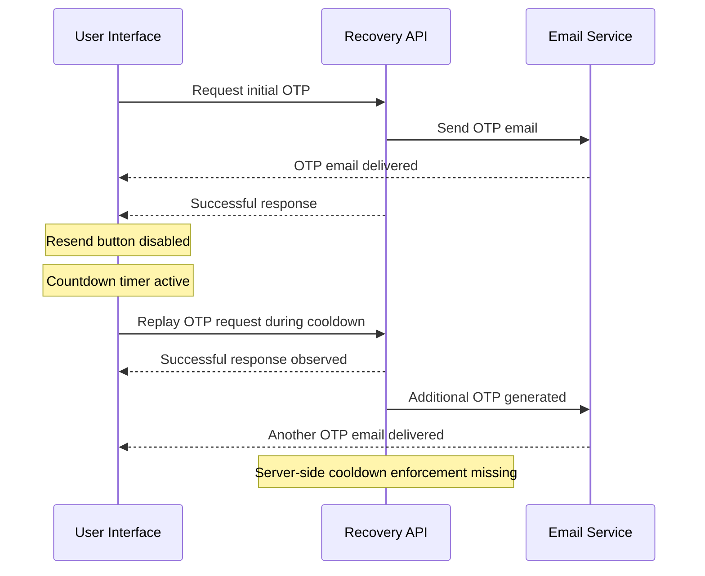
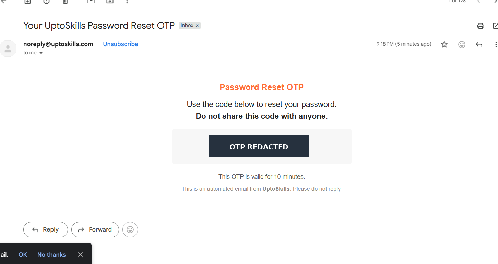
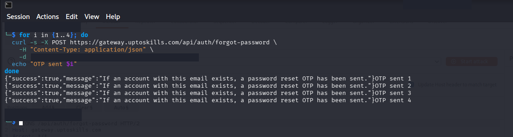
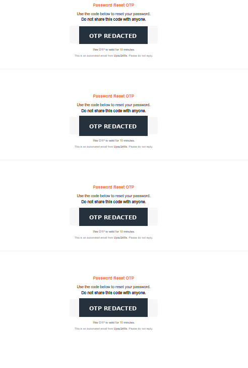

# OTP Resend Cooldown Bypass: When a Frontend Timer Is Not a Security Control

> **Key finding:** During a historical assessment, the password-recovery interface displayed a resend countdown, yet direct requests to the same recovery API returned successful responses. The research team also captured **four distinct OTP emails** associated with the repeated requests. This provides evidence of a weakness in enforcing the intended resend cooldown at the backend.
>
> **Evidence limitation:** The screenshots do not include synchronized timestamps tying each HTTP request and email delivery to the **same** frontend countdown. The original report states that the actions occurred during the active timer; the images corroborate the separate elements of that sequence, but not its timing to the second.

## 1. Vulnerability overview

| Field | Details |
| --- | --- |
| Original report | *Missing Server-Side Validation on OTP Resend Cooldown (OTP Flooding Vulnerability)* |
| Assessment topic | OTP resend cooldown / password-recovery request throttling |
| Application | UpToSkills |
| Affected endpoint | `POST https://gateway.uptoskills.com/api/auth/forgot-password` |
| Attack surface | Public *Forgot Password* and *Resend OTP* flow |
| Testing date | **4 July 2026** |
| Tools documented | Burp Suite Community Edition v2025.10.6; terminal/cURL evidence |
| Severity | Not assigned in the original report; impact depends on actual abuse controls |
| Evidence status | Repeated positive API responses and multiple OTP deliveries documented; exact timer-overlap not independently timestamped |

## 2. How the OTP resend flow should work

Password-recovery flows usually issue a short-lived one-time password (OTP) to an address associated with an account. To limit repeated messages, the application can impose a resend cooldown and a broader request budget.

The visual countdown is useful feedback, but it runs in a browser controlled by the user. If the API does not independently enforce the same policy, bypassing the interface may allow more recovery requests than the UI implies.

**The trust boundary is the important part:** The backend must decide whether another OTP is allowed; a disabled button must never be the only gate.



## 3. Authorized testing setup

The original assessment used the application’s password-recovery workflow, a registered test email address, Burp Suite, and repeated HTTP requests. This write-up is a **historical reconstruction**, not a claim about the present production configuration.

For safe publication, the original test mailbox, all OTP values, and nonessential local identifiers have been removed from the figures. No live credentials, request cookies, or working recovery codes are included.

## 4. Reproduction sequence and evidence

### Step 1 - Open the login and password-recovery interface

The researcher navigated to the UpToSkills login page and selected the **Forgot Password** option.


*Figure 1 - Login screen with the recovery entry point visible (original report, Figure 1).*

### Step 2 - Submit an account-controlled email address

The recovery form accepted a registered email address and offered a **Send OTP** action. The screenshot below is preserved from the report, with the test email opaque-redacted.


*Figure 2 - Password-recovery form. The tester’s email has been removed.*

### Step 3 - Verify the initial OTP email

The researchers received an email titled **“Your UptoSkills Password Reset OTP”**. The email describes the code as valid for **10 minutes**, according to the screenshot. This establishes an initial functional recovery email path; it does not by itself show the resend bypass.



*Figure 3 - Initial recovery OTP delivery. The actual code is covered by an opaque mask.*

### Step 4 - Observe the frontend cooldown

After requesting an OTP, the user interface displayed the resend countdown. The screenshot records the text **“Resend OTP in 92s.”**


*Figure 4 - The application tells the user to wait before requesting another OTP.*

### Step 5 - Examine direct API behavior during repeat requests

The team used direct HTTP requests to the recovery endpoint instead of clicking the disabled UI control. The terminal screenshot shows a **four-request test**, with four JSON responses reporting `"success": true` and the generic message that a reset OTP has been sent *if the account exists*.

A sanitized representation of the **request structure** in the report is:

```http
POST /api/auth/forgot-password HTTP/2
Host: gateway.uptoskills.com
Content-Type: application/json

{"email":"<AUTHORIZED_TEST_EMAIL>"}
```

The response text, as shown in the screenshot, is:

```json
{
  "success": true,
  "message": "If an account with this email exists, a password reset OTP has been sent."
}
```



*Figure 5 - Low-volume direct-request test and four success responses. The email address is opaque-redacted.*

**Interpretation:** A generic success response alone cannot prove email delivery, because this wording may be intended to prevent account enumeration. The next piece of evidence matters.

### Step 6 - Correlate with delivered OTP emails

The report includes a screenshot containing **four separate recovery email bodies**, each showing a different OTP value. The codes are fully redacted in the public copy.



*Figure 6 - Four distinct OTP emails captured by the research team. All codes have been masked.*

Taken together, the terminal output and the delivered-email screenshot support the report’s central observation: the recovery workflow could generate multiple OTP messages under the tested conditions. The written report states that this occurred while the browser still showed the cooldown.

**What remains unverified from the public screenshots:** precise request/receipt timestamps, whether a retry was accepted *before* the shown countdown expired, the maximum sustainable request rate, and the server’s internal cooldown configuration.

## 5. Expected behavior vs. observed behavior

| Security property | Expected | Historical observation |
| --- | --- | --- |
| Frontend cooldown | Prevent another UI submission until the timer expires | **Observed:** the interface displayed `Resend OTP in 92s` |
| Backend cooldown | Reject or defer early resend requests regardless of UI | **Reported weakness:** direct requests were accepted during the timer |
| Repeated API responses | If throttled, return a controlled limit response such as `429` | **Observed:** four generic `success: true` responses |
| OTP delivery | Avoid generating a new OTP for each prohibited resend | **Observed:** four distinct received OTP email bodies |
| Evidence of broad flood/DoS impact | Requires capacity/volume measurements | **Not demonstrated** |

## 6. Security impact

### Demonstrated within the test

- Multiple direct recovery requests returned positive API-level responses.
- Multiple distinct OTP emails were received by the test mailbox.
- The UI exposed a resend cooldown, while the report states the direct API flow did not respect it.

### Potential consequences if abuse controls are insufficient

- **Inbox flooding:** repeated unsolicited recovery messages can disrupt or annoy account owners.
- **Infrastructure overhead:** repeated OTP generation, delivery, and logging can consume email and application resources.
- **Recovery-process interference:** successive codes may create confusion or invalidate previous codes, depending on backend logic (not tested here).
- **Availability impact:** sustained high-volume misuse might affect recovery service quality, but **no denial of service was demonstrated**.

## 7. Root-cause assessment

The original team described the issue as **missing server-side cooldown enforcement**. The UI/backend discrepancy is consistent with that hypothesis, but no backend source code or configuration was provided. Other explanations (for example, absent or overly permissive endpoint limits) are possible.

What the evidence supports most directly is a **security-control gap at the API boundary**: the system accepted a small burst of requests and delivered multiple recovery messages despite presenting a waiting period in the browser.

## 8. Recommended remediation

1. **Enforce cooldowns on the server.** Persist the last eligible recovery-request time per account or normalized recipient and check it before generating another code or sending mail.
2. **Make checks atomic.** Use a transactional write or shared cache operation so concurrent requests cannot slip past the same cooldown.
3. **Apply layered limits.** Combine per-account and per-source limits with sensible overall delivery quotas, avoiding permanent lockout of legitimate users.
4. **Return appropriate feedback.** Once the policy is exceeded, use `429 Too Many Requests` and `Retry-After` where appropriate, while maintaining a response strategy that does not expose whether an address is registered.
5. **Protect OTP lifecycle.** Set an expiration time, control issuance/rotation semantics, and ensure older codes are invalidated according to a documented policy.
6. **Monitor safely.** Alert on abnormal recovery traffic without logging OTP values or other secrets.
7. **Keep the frontend timer as UX.** The countdown should reflect the server’s policy; it should not implement the security policy by itself.

### Verification criteria for remediation

Test the fix in an **authorized staging environment** using an owned mailbox:

| Regression test | Passing result |
| --- | --- |
| First eligible recovery request | Standard generic response and, for a valid test account, one message |
| Repeat request before cooldown expires | No second OTP delivered; limited request handled according to policy |
| Direct HTTP request while UI button is disabled | Exactly the same policy enforcement as the UI path |
| Two requests arriving nearly together | At most the permitted number of sends |
| Request after cooldown | Eligible request succeeds normally |
| Sustained recovery requests within approved test limits | Delivery quota and monitoring behave as configured |

## 9. Lessons from the assessment

The security lesson is not simply that a countdown can be bypassed. It is that **browser interface state is not a security boundary**. A professionally designed recovery flow must retain server-side control over both OTP generation and delivery, even when clients submit requests directly.

The evidence in this report also illustrates an important testing discipline: *different proofs answer different questions*. Successful API responses show what the server reported; distinct received emails strengthen the delivery claim; timestamped request-to-email correlation would be required to independently prove the precise cooldown overlap.

## 10. Conclusion

The historical assessment documents four successful recovery API responses and four distinct OTP emails, while also showing a frontend resend countdown. These observations support the researchers’ finding that OTP resend controls were not sufficiently enforced at the server boundary under the tested conditions.


---
