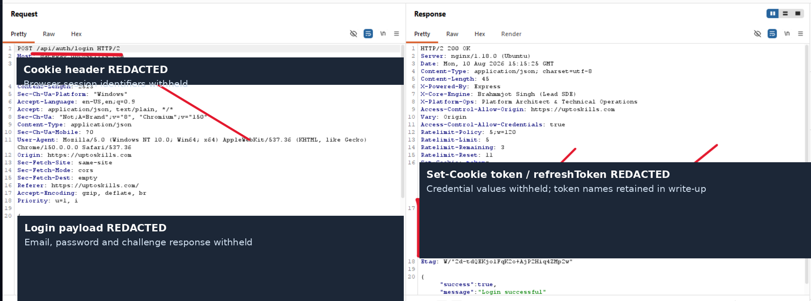
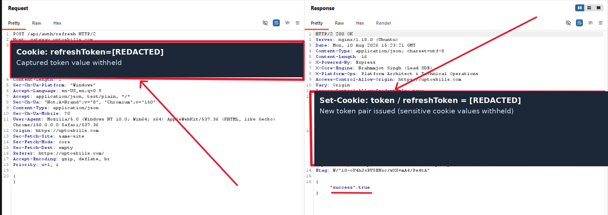
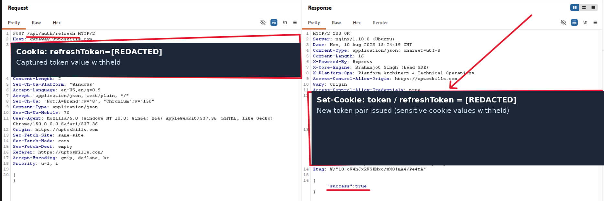
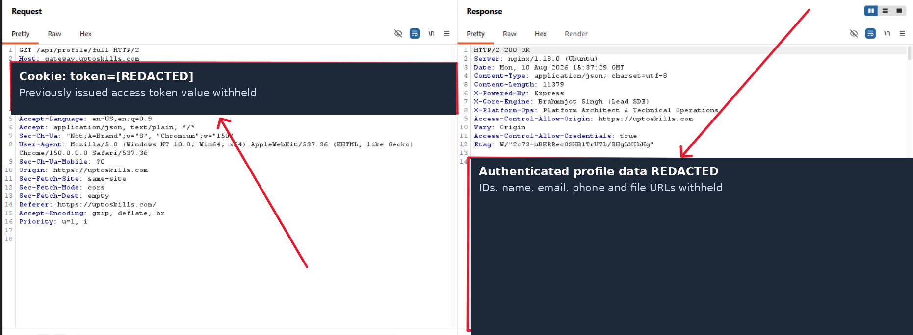

# When a Refresh Token Can Be Used Twice: A Token-Rotation Case Study

**Authentication & session management | API security**

> **Key finding:** In an authorized test of UpToSkills, a refresh token that had already been used to obtain new credentials was accepted again by the refresh endpoint. Both requests returned `HTTP 200 OK` and issued another access-token/refresh-token pair. This is a deviation from the *single-use refresh-token rotation* behavior expected in the original assessment.
>
> **Evidence scope:** Historical assessment dated **10 August 2026**. Confirmed behavior within the supplied test; **current production status and remediation status are unknown**. An additional observation about an older access token is discussed separately because it is not necessarily a vulnerability.

## 1. At a glance

| Field | Details |
| --- | --- |
| Research focus | Refresh-token reuse after an apparent rotation |
| Application | UpToSkills |
| Affected API | `POST https://gateway.uptoskills.com/api/auth/refresh` |
| Supporting endpoint | `GET https://gateway.uptoskills.com/api/profile/full` |
| Vulnerability class | Authentication / session management / token lifecycle |
| Suggested severity in original report | **High** |
| Testing method | Manual authenticated API testing using Burp Suite and a browser |
| Test access | Authorized test account |
| Date of assessment | 10 August 2026 |
| Observed behavior | A previously used refresh token was accepted more than once |

## 2. The idea behind the test

An **access token** lets an authenticated client access protected routes for a limited time. A **refresh token** can be exchanged for newer credentials without asking the user to sign in again.

In a **single-use rotating refresh-token** design, the current refresh token should be consumed as part of a successful exchange. The old token becomes invalid, while the newly issued refresh token is the only one permitted for the next exchange.

```text
Single-use rotation (expected for this design)

  Login                 Refresh #1                   Refresh #2
    │                      │                            │
    ▼                      ▼                            ▼
  R0 issued ───────► R0 consumed, R1 issued ───────► R1 consumed, R2 issued
                            │
                            └── Reusing R0 → REJECT
```

**Why it matters:** If an attacker obtains a refresh token, a one-time-use rotation design can limit the opportunity to replay that credential and can allow reuse detection to trigger session-family revocation. Without single-use enforcement, the old credential may remain useful until its own expiry or revocation.

This risk is **conditional on token exposure**. The assessment did **not** demonstrate theft of a token, access to another user's account, or use after expiry.

## 3. Scope and testing setup

The assessment used a researcher-controlled account and observed the application's HTTP requests and responses in Burp Suite.

The screenshots show:

- Login through `POST /api/auth/login` returning cookies named `token` and `refreshToken`.
- Refresh requests using the `refreshToken` **cookie**.
- Successful responses setting both a new `token` cookie and a new `refreshToken` cookie.
- A protected profile request using a previously issued `token` cookie.

The original report's PoC text refers generally to a `refreshToken` parameter, while the included **Burp screenshots specifically show cookie-based transmission**. The examples below follow the screenshot evidence.

**Privacy and evidence handling:** Every image in `assets/` is derived from the supplied Burp screenshots, with **opaque redactions** over session cookies, credentials, CAPTCHA data, and profile information. No reusable token or private profile value is intentionally included in this repository.

## 4. Reproduction and observations

### Step 1 — Authenticate and capture the issued tokens

Using an authorized test account, the researcher signed in and observed the application's login response.

**Observed:** `HTTP/2 200 OK`, a successful login response, and `Set-Cookie` headers for the access and refresh tokens.



*Figure 1 — Initial login and credential issuance. Cookies, login fields, and challenge data have been redacted.*

### Step 2 — Use the refresh token once

The captured refresh token was submitted to the refresh endpoint through the cookie header:

```http
POST /api/auth/refresh HTTP/2
Host: gateway.uptoskills.com
Cookie: refreshToken=<REDACTED_TEST_TOKEN_R0>
Content-Type: application/json

{}
```

The successful response returned new credentials:

```http
HTTP/2 200 OK
Set-Cookie: token=<REDACTED_ACCESS_TOKEN_A1>; ...
Set-Cookie: refreshToken=<REDACTED_REFRESH_TOKEN_R1>; ...
Content-Type: application/json; charset=utf-8

{"success":true}
```

The first successful refresh response is recorded in the screenshot at **15:23:21 GMT**, 10 August 2026.



*Figure 2 — Initial refresh request accepted. The server returns `200 OK`, `success: true`, and fresh cookies.*

### Step 3 — Reuse the *previously consumed* refresh token

Instead of sending the newly issued `R1`, the researcher **replayed the earlier `R0` refresh token**.

```http
POST /api/auth/refresh HTTP/2
Host: gateway.uptoskills.com
Cookie: refreshToken=<SAME_REDACTED_TEST_TOKEN_R0>
Content-Type: application/json

{}
```

**Observed result:** The endpoint again returned `HTTP/2 200 OK`, `success: true`, and additional token cookies. The source screenshot is dated **15:24:19 GMT**, 10 August 2026.



*Figure 3 — A previous refresh token was accepted again, according to the original test sequence. Cookie values are fully redacted in this public version.*

**This is the central finding.** The source report states the same previously used refresh token was submitted unchanged. The public screenshots preserve the endpoint and response status while obscuring the actual credential values, so the exact token-byte equality cannot be independently checked from the sanitized files.

### Step 4 — Check an older access token (separate observation)

The researcher then sent a request to a protected profile endpoint using an access token that had been issued before a newer access token:

```http
GET /api/profile/full HTTP/2
Host: gateway.uptoskills.com
Cookie: token=<REDACTED_OLDER_ACCESS_TOKEN>
```

**Observed:** `HTTP/2 200 OK` and authenticated profile data; the supplied screenshot is dated **15:37:29 GMT**, 10 August 2026.



*Figure 4 — The older access token accessed the protected profile. All personal data and document locations have been redacted.*

**Important distinction:** Rotating a refresh token does **not**, by default, invalidate every previously issued access token. An older access token remaining valid **until its scheduled expiry** is normal in many JWT-based designs. This is a useful session-lifecycle observation but **not an independently proven weakness** without evidence that the access token should already have expired or been revoked.

## 5. Evidence timeline

| Step | Evidence | Observed result |
| --- | --- | --- |
| Login | Figure 1 — `POST /api/auth/login` | Successful login; access and refresh cookies issued |
| First refresh — 15:23:21 GMT | Figure 2 — `POST /api/auth/refresh` | `200 OK`; new token pair issued |
| Reuse of earlier token — 15:24:19 GMT | Figure 3 — same endpoint | `200 OK`; another token pair issued |
| Older access token — 15:37:29 GMT | Figure 4 — `GET /api/profile/full` | `200 OK`; authenticated profile data returned |

All times shown above are from the original Burp response headers on **10 August 2026**. Their role is to describe the recorded test, not the service's current behavior.

## 6. Expected vs. actual behavior

| Check | Expected in a single-use rotation design | Observed in the assessment |
| --- | --- | --- |
| First use of `R0` | Accept; issue `A1` and `R1` | Accepted (`200 OK`) |
| Second use of **the same** `R0` | Reject as consumed; optionally trigger reuse detection | Accepted again (`200 OK`) |
| Use of `R1` | Accept if valid, unexpired, and not already consumed | Not independently tested in the report |
| Use of older access token | Follow the configured access-token expiry/revocation policy | Still accepted at the tested time |
| After logout / revocation / expiration | Reject affected revoked or expired credentials | Not tested in the supplied evidence |

## 7. Security impact

**Demonstrated:** A previously used refresh credential was reportedly accepted again, returning fresh credentials rather than being rejected as consumed.

**Potential, conditional impact:** If a valid refresh token is leaked or stolen, an attacker might be able to continue obtaining new access credentials while the token remains valid. This could undermine the intended protection of one-time rotation and complicate session-reuse detection.

**Not demonstrated in the source:** token theft, compromise of another user, successful replay after expiry, persistence after explicit logout or revocation, access-control bypass, or a production incident.

The original report labels the issue **High** severity.

## 8. Likely cause and engineering considerations

The observed pattern is **consistent with** incomplete enforcement of single-use refresh-token semantics. For example, a system may issue a new token without atomically marking the previous refresh token as consumed, or may accept any valid signed refresh JWT until expiry.

A secure rotation implementation must also consider concurrent refresh requests and short-lived retry races: naive reuse detection can mistakenly terminate legitimate sessions if multiple client requests refresh simultaneously.

## 9. Recommended remediation

1. **Make refresh credentials single-use where rotation is intended.** On a successful exchange, atomically consume the presented token and issue its replacement.
2. **Track token state server-side** using opaque/token-family identifiers or hashed refresh-token records; avoid retaining raw refresh tokens in logs.
3. **Detect reuse.** A consumed refresh token should not issue fresh credentials. Depending on the threat model, revoke the associated token family and require reauthentication.
4. **Handle concurrency deliberately.** Define safe race handling without allowing old tokens to create unlimited successor sessions.
5. **Set finite expiry and revocation controls.** Support logout, credential-reset, and suspicious-session revocation policies.
6. **Review access-token expectations separately.** Short-lived access tokens and explicit revocation strategies are preferable to assuming refresh rotation automatically cancels access tokens.
7. **Monitor suspicious events** while keeping raw tokens, account credentials, and personal profile data out of telemetry.

### Regression tests for the fix

| Test | Expected after remediation |
| --- | --- |
| Use valid fresh `R0` | Success; issue `R1`; mark `R0` consumed |
| Replay `R0` after successful exchange | Rejected; no new credentials |
| Use valid `R1` | Success; issue `R2` |
| Submit expired or revoked refresh token | Rejected |
| Send simultaneous refresh requests with `R0` | Behavior follows documented atomic/race policy; no unbounded token family |
| Test access-token validity | Honors its separate expiry/revocation policy |

## 10. Conclusion

The strongest result of this assessment is **refresh-token reuse after a successful refresh operation**. In a system claiming single-use refresh-token rotation, accepting a consumed token again defeats the purpose of that control and warrants investigation.

The continued validity of an older access token is documented as a **separate observation** rather than proof of a second flaw. The scope of this historical report does not include token theft, account takeover, or post-expiration replay.

---
